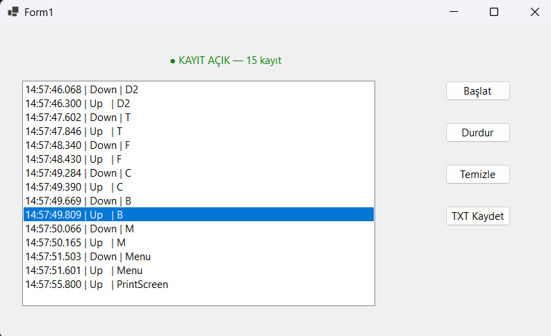
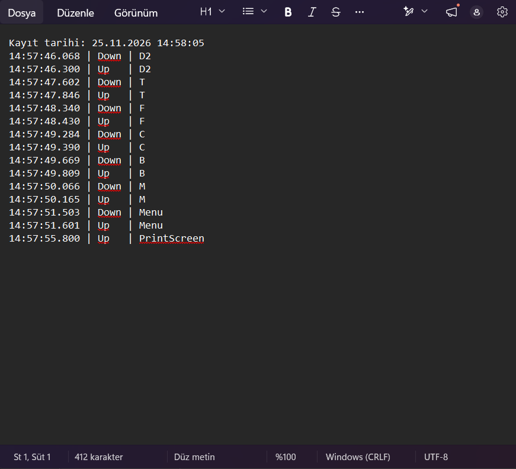

# YMH219 - Key Event Logger (Eğitsel Keylogger)

Nesne Tabanlı Programlama (YMH219) dersi ek uygulama ödevi. Uygulama **yalnızca kendi penceresi aktifken** basılan tuşları zaman bilgisiyle listeler ve isteğe bağlı olarak `.txt` dosyasına kaydeder. Gerçek bir sistem keyloggerı değildir.

## Kullanılan Teknolojiler

- C# / Windows Forms App
- Visual Studio 2026
- `System.Windows.Forms` (KeyDown / KeyUp / PreviewKeyDown olayları)
- `System.IO` (StreamWriter ile dosya kaydı)
- NuGet paketi kullanılmamıştır.

## Kurulum ve Çalıştırma

1. Depoyu klonlayın: `git clone https://github.com/ArdaOzcanCifci/YMH219-KeyEventLogger.git`
2. `YMH219-KeyEventLogger.sln` dosyasını Visual Studio ile açın.
3. `F5` ile derleyip çalıştırın.

**Kullanım:** `Başlat` → pencere odaktayken tuşlara basın → `Durdur` → `TXT Kaydet` ile dosyaya aktarın. `Temizle` tüm kayıtları siler.

## Temel Özellikler

- Basılan tuş adı, olay tipi (Down/Up) ve zaman (`HH:mm:ss.fff`) ListBox'ta listelenir.
- Başlat / Durdur butonları ile kayıt durumu kontrol edilir.
- Renkli durum göstergesi: ● KAYIT AÇIK (yeşil) / ● KAYIT KAPALI (kırmızı) + kayıt sayısı.
- Temizle butonu ekran ve bellekteki kayıtları siler.
- SaveFileDialog + StreamWriter ile `.txt` dosyasına kayıt (dosya hataları MessageBox ile bildirilir).
- Ok tuşları `PreviewKeyDown` / `IsInputKey` ile yakalanır.
- Liste otomatik olarak son kayda kayar.

## Sınıf Yapısı

| Dosya | Görev |
|---|---|
| `KeyLogEntry.cs` | Tek tuş olayı: tuş adı, olay tipi, zaman |
| `KeyLogManager.cs` | Kayıt durumu, kayıt listesi, dosyaya yazma |
| `Form1.cs` | Arayüz, klavye olayları, kullanıcı geri bildirimi |

## Ekran Görüntüleri

**Kayıt açıkken tuş yakalama:**

**TXT dosyasına kaydedilen çıktı:**

## Kapsam ve Güvenlik Sınırı

Föydeki sınırlara uygundur: global keyboard hook, arka planda çalışma, otomatik başlatma, başka uygulamalardan veri toplama veya ağ üzerinden veri gönderme **yoktur**. Yalnızca form odaktayken olay yakalanır.

## Bilinen Sınırlamalar / Geliştirme Notları

- Kayıtlar bellekte tutulur; uygulama kaydedilmeden kapanırsa kayıtlar silinir.
- Pencere odaktan çıkınca yakalama durur (tasarım gereği).
- Tuş istatistiği ve tarih filtresi (isteğe bağlı geliştirmeler) bu sürümde yoktur.

## Öğrenci Bilgileri

- **Ad Soyad:** [Arda Özcan Çifci]
- **Öğrenci No:** [250542012]
- **Ders:** Nesne Tabanlı Programlama (YMH219)
